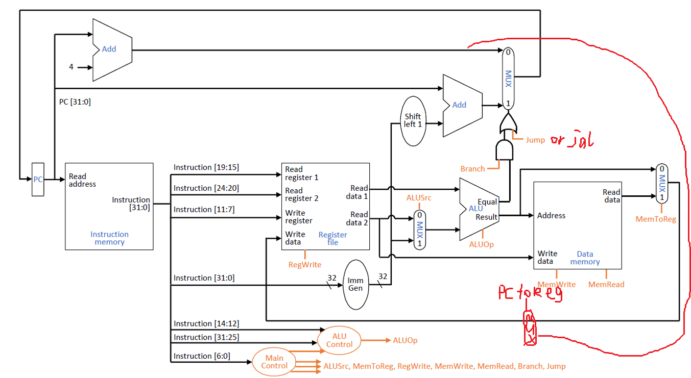
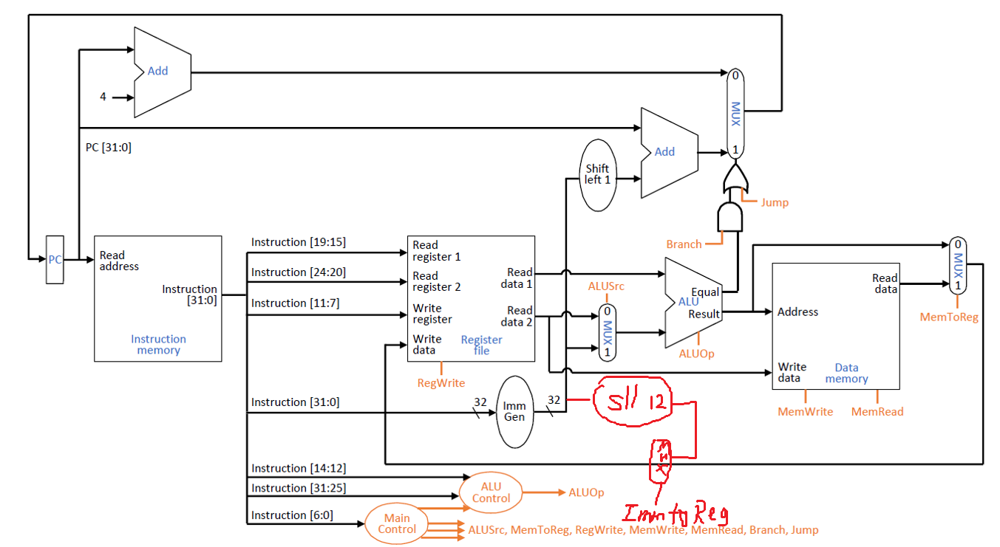
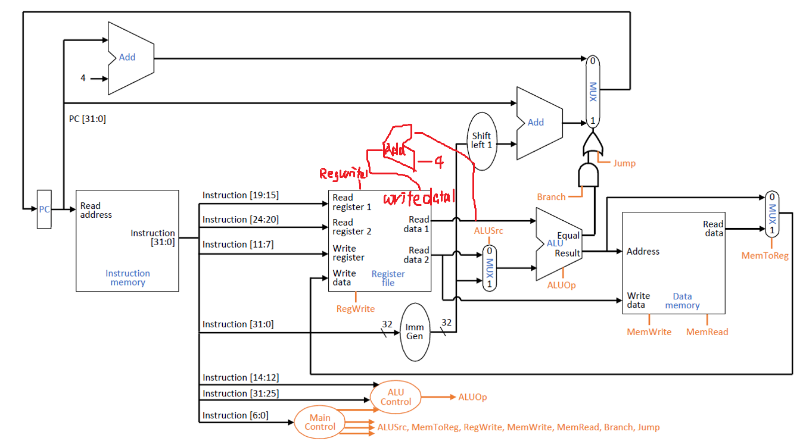

# Week2 Homework

By Deng Yufan.

## Prob 1

### Part A

Line | Reg | Stall w/o fwd | Forwarding | Stall w/ fwd
:---: | :---: | :---: | :---: | :---:
1 & 2 | s1 | 2 | MEM to EX | 0
2 & 3 | t1 | 2 | MEM to EX | 0
3 & 4 | t1 | 2 | MEM to EX | 0
4 & 5 | t2 | 2 | WB to EX | 1

### Part B

Design 1: For branch, always stall 9 cycle. So CPI penalty = 9 * 15% = 1.35.

Design 2: For branch, always stall 3 cycle. So CPI penalty = 3 * 15% = 0.45.

Design 3: If prediction is wrong, need to stall the started 3 instructions. So CPI penalty is 3 * 15% * 65% = 0.2925.

Design 4: For branch, always stall 3 cycle, and if the branch is not taken, stall 6 more cycle. So CPI penalty is 3 * 15% + 6 * 15% * (1 - 65%) = 0.765.

Design 5: For branch, if the branch is not taken, need to stall 9 cycle; else if BTB is wrong, need to stall 3 cycle. So CPI penalty is 9 * 15% * (1 - 65%) + 3 * 15% * 65% * (1 - 40%) = 0.648.

## Prob 2

### Part A

a. For datapath, we can parallelize ALU and MEM, since one instruction will take only either of them. Or say, we don't need ALU -> MEM, but REGFILE -> MEM.

For control, we need to add a control called ``type``, to tell whether we need ALU or MEM.

b. Reason 1: Change of datapath decreased the length of critical path, so the CCT will decrase.

Reason 2: We cut off the offset in lw/sw, then we have more bits to speedup the ID process.

### Part B

a. We can implement ``swap rd, rt`` as:

```asm
xor     rd, rd, rt    # rd = rd ^ rt
xor     rt, rd, rt    # rt = rd
xor     rd, rd, rt    # rd = rt
```

b. Let there is p% swap operations. If we don't implement swap, we need N * (1 + 2p%) cycle; if we implement swap, we need N cycle.

If implement swap will make cycle q% longer, we want 1 + 2p% > 1 + q%, so p > q / 2.

For 12% latency, we need at least 6% swap; for 20% latency, we need at least 10% swap.

## Prob 3

### Part A

a. As the figure.



b. As the figure.



### Part B

As the figure.



## Prob 4

a.

Instr. | 0 | 1 | 2 | 3 | 4 | 5 | 6 | 7 | 8 | 9 | 10 | 11 | 12 | 13 | 14
:---: | :---: | :---: | :---: | :---: | :---: | :---: | :---: | :---: | :---: | :---: | :---: | :---: | :---: | :---: | :---:
1 | IF | ID | EX | MEM | WB
2 | | IF | ID | - | EX | MEM | WB
3 | | | IF | - | ID | EX | MEM | WB
4 | | | | - | IF | ID | - | EX | MEM | WB
5 | | | | | | IF | - | ID | EX | MEM | WB
6 | | | | | | | - | IF | ID | EX | MEM | WB
7 | | | | | | | | | IF | ID | EX | MEM | WB
8 | | | | | | | | | | IF | ID | EX | MEM | WB
9 | | | | | | | | | | | IF | ID | EX | MEM | WB

Total 15 cycles. The last 2 cycle can't be displayed well in pdf file.

b.

Instr. | 9 | 10 | 11 | 12 | 13 | 14 | 15 | 16 | 17 | 18 | 19
:---: | :---: | :---: | :---: | :---: | :---: | :---: | :---: | :---: | :---: | :---: | :---:
8 | IF | ID | EX | MEM | WB
9 | | IF | ID | EX | MEM | WB
1 | | | - | - | IF | ID | EX | MEM | WB
2 | | | | | | IF | ID | - | EX | MEM | WB

17 cycles per iteration, so  CPI = 17/9 = 1.89.

c.

Possible optimal code:

```asm
loop:
1 lw      t0, 0(s1)     # load X[i]
2 lw      t2, 0(s2)     # load Y[i]
3 slli    t1, t0, 3     # calculate 8*X[i]
4 add     t3, t2, t1    # calculate 8*X[i]+Y[i]
5 sw      t3, 0(s2)     # store Y[i]
6 addi    s1, s1, 4     # increment X index
7 addi    s2, s2, 4     # increment Y index
8 addi    s3, s3, 1     # increment i
9 bne     s3, s9, loop  # loop
finish:
```

Total 13 cycles.
